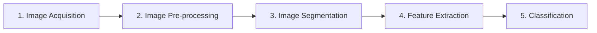
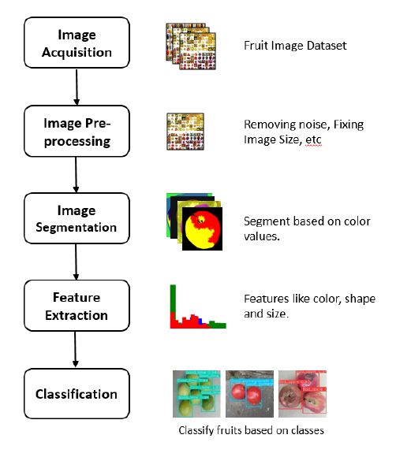
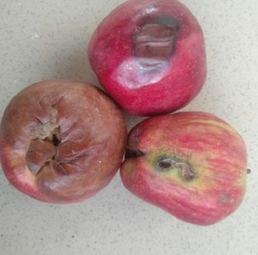
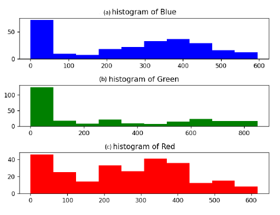
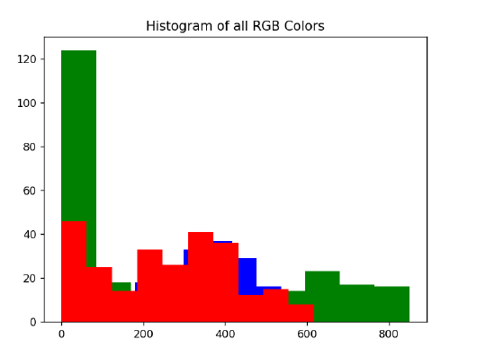
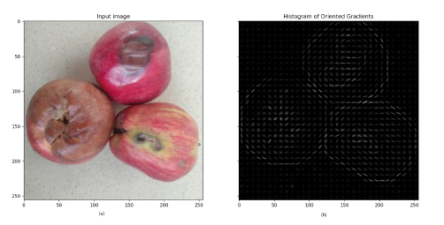
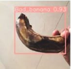
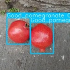
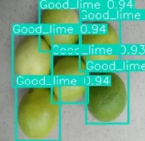

# 🍎 Fruit Quality Assessment using Supervised Learning Techniques based on Image Features

An automated, non-destructive **fruit quality detection (FQD)** system that classifies fruits as **good** or **bad** quality using classical image-processing features (HOG, colour histograms, mean colour) combined with supervised machine-learning and deep-learning models. Nine classifiers are compared on the **FruitsGB: Top Indian Fruits Quality** dataset, and **Random Forest** turns out to be the best performer.

---

## 📌 Abstract

Growing global population demands fruit production at scale, and traditional manual handling and packaging methods are slow. This work proposes an image-processing + machine-learning pipeline for classifying fruit quality. Image features such as colour, texture, edges and shape are extracted using **Histogram of Oriented Gradients (HOG)**, colour histograms and mean colour. Several models — **ANN, CNN, GNN, KNN, SVM, Random Forest, Naive Bayes, Logistic Regression and Linear Regression** — are evaluated for feasibility. Experiments on the *FruitsGB* dataset (12,000 images, good/bad labels) show that **Random Forest achieves the best results with a test accuracy of 97.75 %** along with the highest precision, recall and F1-score. The approach is cost-effective and time-saving for quality control across the agricultural supply chain.

**Keywords:** Fruit Quality Detection · Image Processing · Machine Learning · Histogram of Oriented Gradients · Grading Scale

---

## 🧭 Table of Contents

1. [Pipeline Overview](#-pipeline-overview)
2. [Dataset](#-dataset)
3. [Feature Extraction](#-feature-extraction)
4. [Models Compared](#-models-compared)
5. [Evaluation Metrics](#-evaluation-metrics)
6. [Training Time & Complexity](#-training-time--complexity)
7. [Results](#-results)
8. [Qualitative Results](#-qualitative-results)
9. [Conclusion & Future Work](#-conclusion--future-work)
10. [References](#-references)
11. [Citation](#-citation)

---

## 🔄 Pipeline Overview

The fruit quality inspection process follows five stages :

  
   <em>Fig. 1 – Processing stages in Fruit Quality Detection</em>

| Stage | Description |
|-------|-------------|
| **(a) Image Acquisition** | Acquire high-resolution fruit images to enable accurate feature extraction. |
| **(b) Image Pre-processing** | Remove noise, resize to a uniform size, convert to grayscale where needed, and validate that images load correctly (no corrupted/incompatible files). |
| **(c) Image Segmentation** | Isolate regions of interest and faulty areas using colour/texture-based techniques such as thresholding and clustering. |
| **(d) Feature Extraction** | Extract HOG descriptors, mean colour values and colour histograms. |
| **(e) Classification** | ML models classify fruit as *good* or *defective* based on the extracted features and predefined quality standards. |

### Pre-processing highlights
- **Resizing** to a uniform size ensures consistency and reduces computation.
- **Grayscale conversion** reduces data to one channel, emphasising texture/structure for shape analysis and edge detection.
- **Feature extraction** reduces dimensionality, keeps the most informative content and maximises between-class differences.
- **Feature selection** removes irrelevant/duplicate features, reducing noise, storage and compute while improving accuracy.

---

## 🗂 Dataset

**FruitsGB: Top Indian Fruits Quality** (IEEE Dataport, Meshram et al., 2020)

- **12,000** high-resolution images
- **12 categories** of fruits, each labelled **Good** or **Bad** (e.g. *"Good Apple"*, *"Bad Orange"*)
- Includes fruits such as **Apple, Banana, Guava, Lime, Orange and Pomegranate**
- Data split: **80 % training / 20 % testing**; features standardised with `StandardScaler`

---

## 🎨 Feature Extraction

Three complementary descriptors are extracted and then **fused** into a single feature vector.

### 1. Colour Histograms
Describe the distribution of pixel colour values per channel; normalised and mapped to feature vectors for colour-content-based classification.

  
   <em>Fig. 2 – Original image (apples)</em>

  
   <em>Fig. 3 – Histograms of Blue, Green and Red channels</em>

  
   <em>Fig. 4 – Histogram of combined RGB colour channels</em>

### 2. Histogram of Oriented Gradients (HOG)
Splits the image into small cells and computes a histogram of gradient/edge directions per cell. The combined histograms describe structural image features and work best for objects with well-defined boundaries.

  
   <em>Fig. 5 – (a) Original image, (b) HOG image</em>

### 3. Mean Colour
Mean intensity of the R, G and B channels, giving a quick summary of an image's colour content.

### 4. Feature Fusion (Merging Features)
Colour histograms + HOG descriptors + mean colour are concatenated to form a richer, more holistic image description, which yields more accurate and reliable classification.

---

## 🤖 Models Compared

| Model | Role in this work |
|-------|-------------------|
| **Linear Regression** | Models relationships between fruit characteristics (size, colour, texture); least-squares fit. |
| **Logistic Regression** | Probabilistic classifier (`max_iter = 1000` in scikit-learn). |
| **Naive Bayes** | Bayes' theorem with feature-independence assumption; fast training and prediction. |
| **Random Forest** | Ensemble of decision trees on bootstrapped samples/feature subsets; majority vote. |
| **SVM** | Linear kernel on normalised features; tuned with `GridSearchCV`. |
| **ANN** | Input, hidden and output layers; learns by adjusting connection weights. |
| **KNN** | Euclidean-distance, majority-vote classifier; sensitive to the choice of K. |
| **CNN** | Deep network that learns spatial feature hierarchies automatically. |
| **GNN** | Learns on graph-structured data (nodes & edges) to integrate spatial/relational information. |

> YOLOv8 is also shown in the qualitative figures (Figs. 6–8) for detection-style visualisation.

---

## 📏 Evaluation Metrics

| Metric | Meaning | When it matters |
|--------|---------|-----------------|
| **Accuracy** | Correct predictions ÷ total predictions | Balanced datasets; can mislead on skewed data. |
| **Precision** | Proportion of predicted positives that are truly positive | When false positives must be low. |
| **Recall (Sensitivity)** | Proportion of actual positives correctly found | When missing positives is costly. |
| **F1-Score** | Harmonic mean of precision and recall | When false positives and false negatives matter equally. |

---

## ⏱ Training Time & Complexity

*(n = samples, d = features, h = hidden units, f = filters/features, n_t = trees, k/l = GNN neighbours/layers)*

| Technique | Training Time (mins) | Time Complexity |
|-----------|:-------------------:|:----------------|
| Linear Regression | 7 | O(n · d²) |
| Logistic Regression | 4 | O(n · d²) |
| Naive Bayes | 11 | O(n · d) |
| Random Forest | 15 | O(n_t · n log n) |
| SVM | 22 | O(n² · d) |
| ANN | 33 | O(n · d · h) |
| KNN | 28 | O(n · d) |
| CNN | 40 | O(n · d · f) |
| GNN | 47 | O(n · log n + l · n · k + n · d²) |

**Takeaways**
- Random Forest strikes a good balance between speed and efficiency.
- SVM is computationally expensive to train; KNN is costly on large datasets at prediction time.
- Naive Bayes and Logistic Regression are computationally cheap.
- CNN/ANN are costly to train but make fast predictions once trained.

---

## 📊 Results

| Model | Train Acc. | Test Acc. | Precision | F1 | Recall |
|-------|:---------:|:---------:|:---------:|:--:|:------:|
| Linear Regression | 20.12% | 87.67% | 20.47% | 21.10% | 21.78% |
| Logistic Regression | 100% | 96.58% | 96.57% | 96.56% | 96.58% |
| Naive Bayes | 87.63% | 85.42% | 86.52% | 84.57% | 87.63% |
| **Random Forest** | **100%** | **97.75%** | **98%** | **98%** | **98%** |
| SVM | 100% | 96.79% | 96.67% | 96.79% | 95.83% |
| ANN | 99.94% | 96.42% | 96% | 96% | 96% |
| KNN | 93.19% | 88.17% | 87.86% | 87.48% | 88.17% |
| CNN | 90.97% | 94.60% | 91.26% | 91.80% | 92.35% |
| GNN | 61.12% | 67.65% | 64.09% | 61.36% | 61.12% |

🏆 **Random Forest** is the best-performing model on every metric, benefiting from its ability to handle high-dimensional data and its resistance to overfitting.

---

## 🖼 Qualitative Results

Predictions of each model (ANN, Naïve Bayes, KNN, Logistic Regression, Random Forest, SVM, YOLOv8, CNN) on sample images from the dataset.

  
   <em>Fig. 6 – Banana classified by various models: (a) Original, (b) ANN, (c) Naïve Bayes, (d) KNN, (e) Logistic Regression, (f) Random Forest, (g) SVM, (h) YOLOv8, (i) CNN</em>

  
   <em>Fig. 7 – Pomegranate classified by various models (same panel layout as Fig. 6)</em>

  
   <em>Fig. 8 – Lime classified by various models (same panel layout as Fig. 6)</em>

---

## ✅ Conclusion & Future Work

Using accuracy, precision, recall and F1-score, nine machine-learning and deep-learning models were compared for fruit quality detection. **Random Forest** emerged as the best option, reaching a **test accuracy of 97.75 %, precision 98 %, recall 98 % and F1 98 %**, thanks to its handling of high-dimensional data and robustness against overfitting.

**Future work:** predict the **price of a fruit** based on its size, shape and quality.

---

## 📚 References

Selected references from the paper:

1. N. Dalal and B. Triggs, "Histograms of oriented gradients for human detection," *CVPR*, 2005.
2. K. Tan et al., "Recognising blueberry fruit of different maturity using histogram oriented gradients and colour features in outdoor scenes," *Biosystems Engineering*, vol. 176, 2018.
3. H. M. Zawbaa et al., "Automatic fruit classification using random forest algorithm," *HIS*, 2014.
4. A. Nosseir and S. E. A. Ahmed, "Automatic classification for fruits' types and identification of rotten ones using k-NN and SVM," *iJOE*, vol. 15, no. 3, 2019.
5. A. Bhargava and A. Bansal, "Automatic detection and grading of multiple fruits by machine learning," *Food Analytical Methods*, vol. 13, 2020.
6. H. Suhendar et al., "Fruit quality classification using convolutional neural network," *J. Phys.: Conf. Ser.*, vol. 2377, 2022.
7. C. D. D. Yu and J. F. Villaverde, "Avocado ripeness classification using graph neural network," *ICCAE*, 2022.
8. M. J. Swain and D. H. Ballard, "Color indexing," *IJCV*, vol. 7, no. 1, 1991.
9. V. Meshram et al., "FruitsGB: Top Indian Fruits with Quality," *IEEE Dataport*, 2020.

